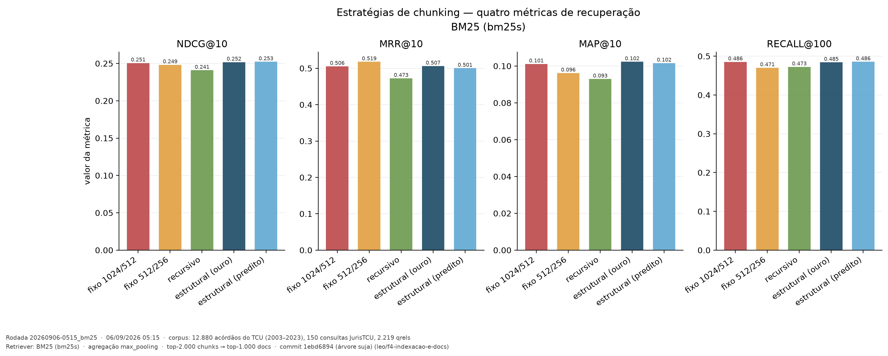
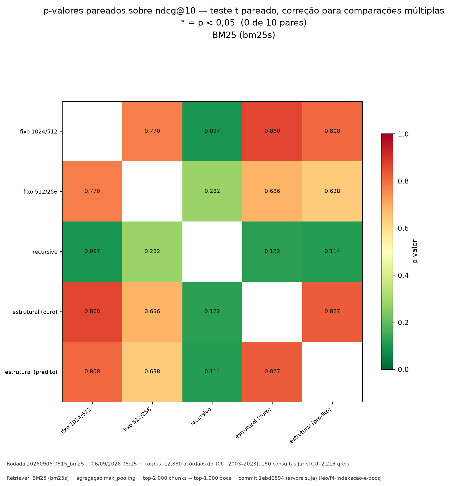
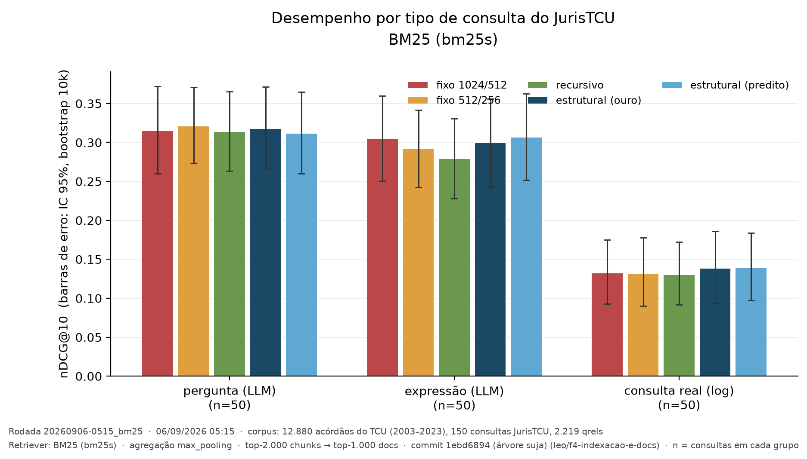
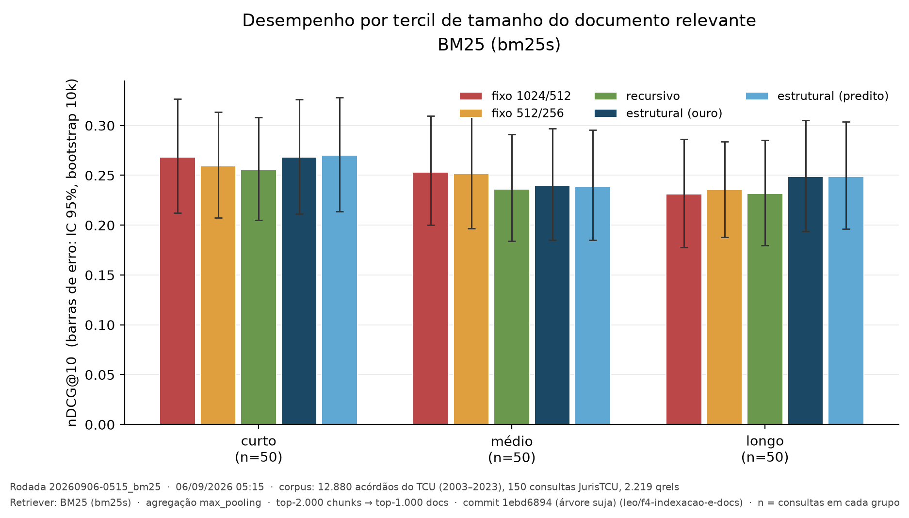
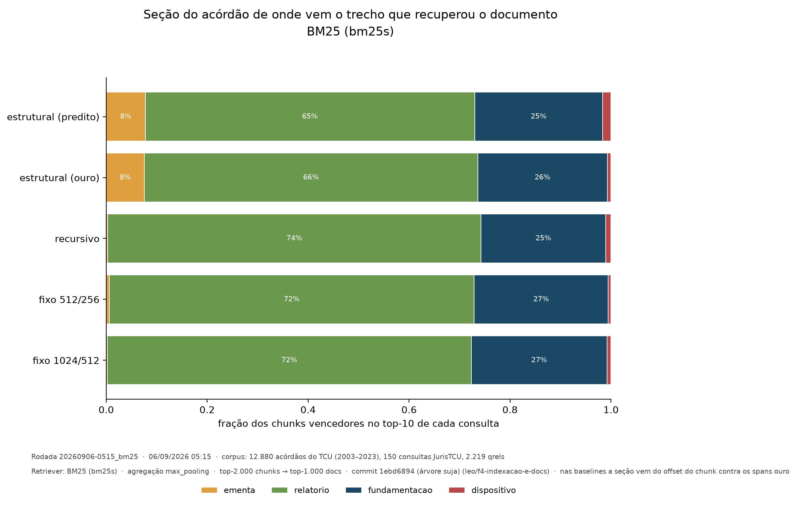

# Resultados — BM25 (5 estratégias)

**Rodada canônica:** `20260906-0515_bm25` · **Data:** 06/09/2026 05:15 · **Autor:** Leonardo Marques
**Corpus:** 12.880 acórdãos do TCU (2003–2023) · 150 consultas JurisTCU · 2.219 qrels
**Retriever:** BM25 (`bm25s`) · agregação max-pooling · top-2.000 chunks → top-1.000 docs
**Commit:** `1ebd6894` · **Status:** ✅ marco da Semana 7 (primeiro número) atingido

> ⚠️ Estes números valem para o corpus de 12.880 documentos. Se a equipe decidir
> mudar o corpus ([08-decisoes-pendentes.md](../08-decisoes-pendentes.md), item 1),
> tudo aqui precisa ser refeito.

## Reprodução exata

Esta rodada é a **segunda execução** do BM25 (a primeira foi a
`20260906-0215_bm25`, em CPU e commit `43d0ffb`). As duas produziram os cinco
nDCG@10 **idênticos até a quarta casa decimal**. Não é sorte: o `bm25s` é
determinístico e a normalização é a mesma. Vale uma frase no artigo — o
pipeline é reproduzível, e a prova está em `results/experiments/`.

A `0515` é a canônica porque tem tudo que a `0215` não tinha: os
`__chunks.jsonl` (que alimentam o recorte por seção), o `power_analysis.csv`
e o manifesto gerado pelo próprio pipeline, não reconstruído à mão.

```bash
python -m src.run_experiments --strategy all --retriever bm25   # 24,5 min
python -m src.evaluate                                          # 0,4 min
python -m src.plots
```

## Tabela principal

| Estratégia | nDCG@10 | MRR@10 | MAP@10 | Recall@100 |
|---|---:|---:|---:|---:|
| **structural_pred** | **0,2526** | 0,5010 | 0,1017 | 0,4863 |
| structural_gold | 0,2521 | 0,5068 | **0,1024** | 0,4849 |
| fixed_1024_512 | 0,2510 | 0,5061 | 0,1013 | **0,4861** |
| fixed_512_256 | 0,2486 | **0,5186** | 0,0963 | 0,4709 |
| recursive_default | 0,2412 | 0,4731 | 0,0931 | 0,4731 |



Artefatos: `results/experiments/20260906-0515_bm25/tables/main_results.csv`
e `figuras/` (PDF para o LaTeX, PNG para o pôster). Toda figura traz no rodapé
a rodada, a data, o corpus, o retriever e o commit — uma imagem copiada para
qualquer lugar continua dizendo de onde veio.

## O resultado honesto: nenhuma diferença é significativa



Dez pares comparados, teste t pareado com correção para comparações múltiplas
sobre nDCG@10: **nenhum p < 0,05** (menor: 0,097). As estruturais aparecem no
topo, mas a diferença para o `fixed_1024_512` é de 0,0016 — ruído. **Não é
possível afirmar, com BM25, que o chunking estrutural melhora a recuperação.**

O verde-escuro da matriz mostra onde as diferenças mais se aproximam da
significância: **todos os pares que envolvem o `recursive_default`**
(p = 0,097 a 0,282). É a única estratégia que se destaca das demais — para
baixo.

Isso é um **resultado nulo bem medido**, que o `plano_tecnico.md` §7 já
antecipava como desfecho legítimo: *"Nada disso exige que a hipótese se
confirme. Um resultado nulo bem medido, com recortes que mostram onde cada
estratégia ganha, é um TCC completo."*

### Poder estatístico: o teste conseguiria ver uma diferença?

`power_analysis.csv` responde à pergunta que a banca faz diante de uma tabela
sem asteriscos — "não há diferença, ou faltou amostra?". Para cada par, o
efeito mínimo detectável (MDE) com 150 consultas, α = 0,05 e poder 0,80, e
quantas consultas seriam necessárias para detectar a diferença observada.

Os 10 pares, ordenados pela diferença observada
(`results/experiments/20260906-0515_bm25/tables/power_analysis.csv`):

| Par | Δ observado | MDE | Detectável? | n necessário |
|---|---:|---:|---|---:|
| recursive_default × structural_pred | −0,0113 | 0,0200 | não | 467 |
| recursive_default × structural_gold | −0,0109 | 0,0196 | não | 486 |
| fixed_1024_512 × recursive_default | +0,0097 | 0,0163 | não | 422 |
| fixed_512_256 × recursive_default | +0,0078 | 0,0201 | não | 1.010 |
| fixed_512_256 × structural_pred | −0,0036 | 0,0212 | não | 5.287 |
| fixed_512_256 × structural_gold | −0,0036 | 0,0216 | não | 5.496 |
| fixed_1024_512 × fixed_512_256 | +0,0024 | 0,0191 | não | 9.309 |
| fixed_1024_512 × structural_pred | −0,0016 | 0,0184 | não | 19.788 |
| fixed_1024_512 × structural_gold | −0,0011 | 0,0181 | não | 37.463 |
| structural_gold × structural_pred | −0,0005 | 0,0058 | não | 24.480 |

Leitura: com 150 consultas e desvio-padrão médio das diferenças de ~0,079, o
experimento detecta diferenças a partir de **~0,016–0,022** em nDCG@10. Os
pares com o `recursive` (Δ ≈ 0,010–0,011) estão **na borda** — com ~420–490
consultas provavelmente seriam significativos. Já a diferença entre estruturais
e fixas (Δ ≤ 0,004) exigiria de 5 mil a 37 mil consultas: **na prática, não
existe.** E o par `gold × pred` tem o menor MDE de todos (0,0058) porque os
dois rankings são quase idênticos consulta a consulta — o teste teria
resolução para ver uma diferença, e não vê.

## Dois achados que valem a pena, apesar do resultado nulo

### 1. O erro do segmentador não custa desempenho

`structural_gold` (spans ouro das colunas do CSV) × `structural_pred` (spans do
nosso segmentador, 92,2% de acurácia):

- nDCG@10: **0,2521 vs 0,2526** — o *predito* fica marginalmente **à frente** do ouro
- p = 0,827; **97 empates em 150 consultas** — em ~2/3 delas o ranking é idêntico
- número de chunks: 286.689 vs 285.308 (**0,48%** de diferença)

**Não é preciso ter a estrutura ouro.** Um segmentador por regras com 92% de
acurácia entrega o mesmo resultado que a estrutura perfeita. Para quem for
aplicar isso num acervo real — onde não existe coluna `SUMARIO`/`VOTO` pronta
— essa é a conclusão prática mais útil do trabalho. É também a ablação que o
BR-TaxQA-R não tem.

### 2. O recursivo é consistentemente o pior

Último em nDCG@10, MRR@10 e MAP@10, e o único que chega perto da significância
contra as demais. Interessante porque é **o padrão de facto** dos pipelines RAG
(o `RecursiveCharacterTextSplitter` de todo tutorial). Se a tendência se
confirmar no denso, o achado vira: *o default do mercado é a pior das cinco
opções* — uma mensagem acionável.

## Recortes analíticos

### Por tipo de consulta — o efeito mais forte de todos



| Estratégia | pergunta (LLM) | expressão (LLM) | **consulta real (log)** |
|---|---:|---:|---:|
| structural_pred | 0,3118 | **0,3069** | **0,1390** |
| structural_gold | 0,3180 | 0,2997 | 0,1386 |
| fixed_1024_512 | 0,3151 | 0,3055 | 0,1323 |
| fixed_512_256 | **0,3214** | 0,2920 | 0,1322 |
| recursive_default | 0,3139 | 0,2793 | 0,1305 |

**O achado aqui não é o chunking — é o tipo de consulta.** Consultas reais de
log rendem **menos da metade** do nDCG das sintéticas (0,13 vs 0,31). A
diferença entre o melhor e o pior chunking dentro de um grupo é de ~3–10%; a
diferença entre grupos é de **~130%**. A escolha da estratégia de chunking é
uma decisão de segunda ordem perto da natureza da consulta — e avaliar RAG
jurídico só com consultas sintéticas de LLM superestima o desempenho em mais
de 2x.

### Por tamanho de documento — a tendência que sustenta a hipótese



| Estratégia | curto | médio | **longo** |
|---|---:|---:|---:|
| structural_gold | 0,2681 | 0,2394 | **0,2489** 🥇 |
| structural_pred | **0,2703** 🥇 | 0,2386 | 0,2488 🥈 |
| fixed_1024_512 | 0,2684 | **0,2532** 🥇 | 0,2313 ⬇️ **último** |
| fixed_512_256 | 0,2596 | 0,2518 | 0,2356 |
| recursive_default | 0,2555 | 0,2363 | 0,2319 |

**A ordem se inverte entre os tercis.** O `fixed_1024_512` é o melhor em
documentos médios e o pior em longos; as estruturais fazem o caminho contrário
(+7,6% sobre ele em longos). É o que a hipótese prevê: quanto mais longo o
acórdão, mais fronteiras uma janela fixa atravessa. **Mas os ICs se sobrepõem
amplamente** — com 50 consultas por tercil não há poder para afirmar. É
tendência, não confirmação.

### Por seção do acórdão — de onde vem o trecho que recuperou o documento



Para cada documento no top-10 de cada consulta, o chunk que deu o score
(o argmax do max-pooling) e a macro-seção de onde ele veio. Nas baselines, que
não rotulam seção, a origem vem do offset do chunk contra os spans ouro — é
por isso que a análise funciona **também** para `fixed` e `recursive`.

| Estratégia | ementa | relatório | fundamentação | dispositivo |
|---|---:|---:|---:|---:|
| structural_pred | **8%** | 65% | 25% | 2% |
| structural_gold | **8%** | 66% | 26% | 1% |
| recursive_default | 0% | 74% | 25% | 1% |
| fixed_512_256 | 0% | 72% | 27% | 1% |
| fixed_1024_512 | 0% | 72% | 27% | 1% |

Duas leituras:

1. **Descompasso entre onde o retriever acha e onde a relevância mora.**
   Em [03-analise-do-dominio.md](../03-analise-do-dominio.md) medimos que 72% da
   relevância julgada está na fundamentação e só 26% no relatório. O BM25 faz
   o **oposto**: 65–74% dos chunks vencedores vêm do relatório, 25–27% da
   fundamentação. O relatório tem 70% do texto, logo tem mais chunks, logo tem
   mais chances de conter o termo da consulta. O BM25 com max-pooling acha o
   termo **onde há mais texto, não onde há mais relevância**.
2. **Só o chunking estrutural recupera pela ementa.** A ementa é 1,3% do
   corpus; uma janela fixa quase sempre a mistura com o começo do relatório, e
   o chunk vencedor é atribuído ao relatório por sobreposição majoritária. As
   estruturais, que respeitam a fronteira, produzem um chunk só de ementa — e
   8% das recuperações vêm dele. É a única diferença qualitativa visível entre
   as famílias no BM25, e não se traduz em nDCG.

## Correções metodológicas feitas no caminho

- **Tercis balanceados.** A primeira versão cortava pelos percentis dos 12.880
  documentos e deu grupos de **3/67/80** consultas — os documentos relevantes
  são sistematicamente maiores que o acervo. Agora corta pelos percentis da
  distribuição das consultas: 50/50/50.
- **Encoding dos arquivos TREC.** O `ranx` lê com o encoding da plataforma e
  transformava `plenário` em `plenário`; as métricas fechavam (qrels e runs
  sofriam a mesma corrupção), mas o recorte por tamanho saía **vazio**.

## Por que BM25 é provavelmente o cenário MENOS favorável à hipótese

Registrado **antes** de rodar o denso, para não parecer racionalização depois
(ver [03-previsao-denso.md](03-previsao-denso.md) para o teste da previsão).

O BM25 casa termos. Com max-pooling, basta que o termo caia em **algum** chunk
do documento para o documento pontuar — a fronteira quase não altera isso. O
retriever denso é outra história: o embedding é uma média semântica do trecho,
e um chunk que atravessa relatório→voto mistura "o que as partes alegaram" com
"o que o relator decidiu". É aí que respeitar a fronteira deveria importar.
