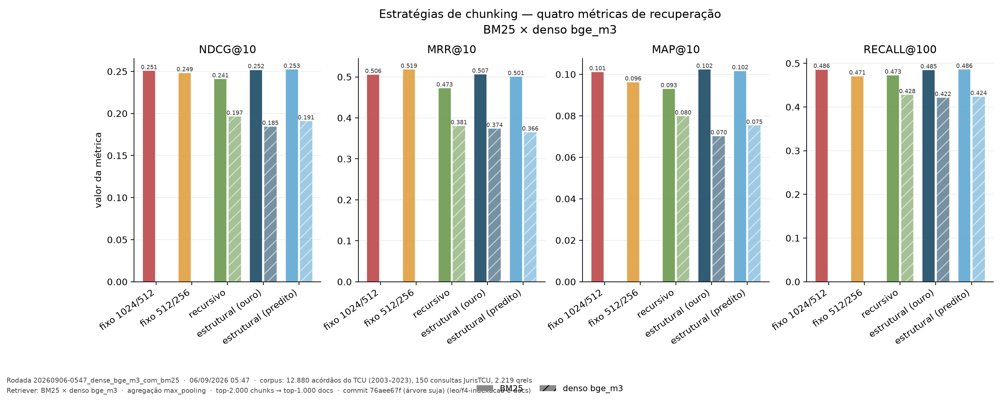
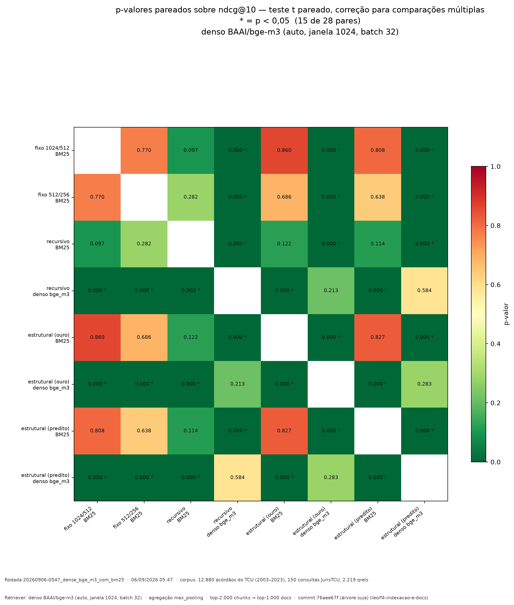
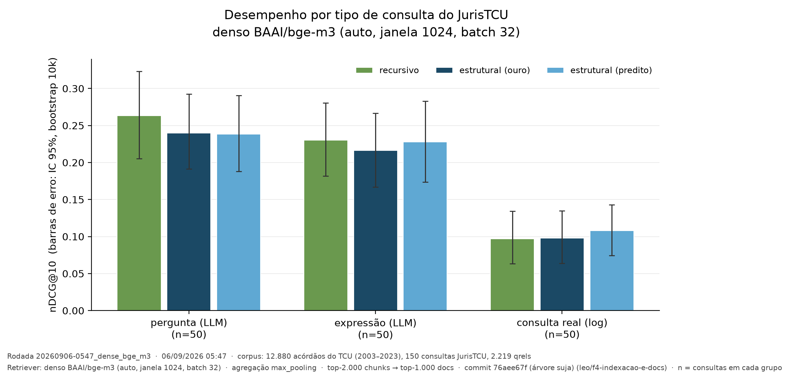
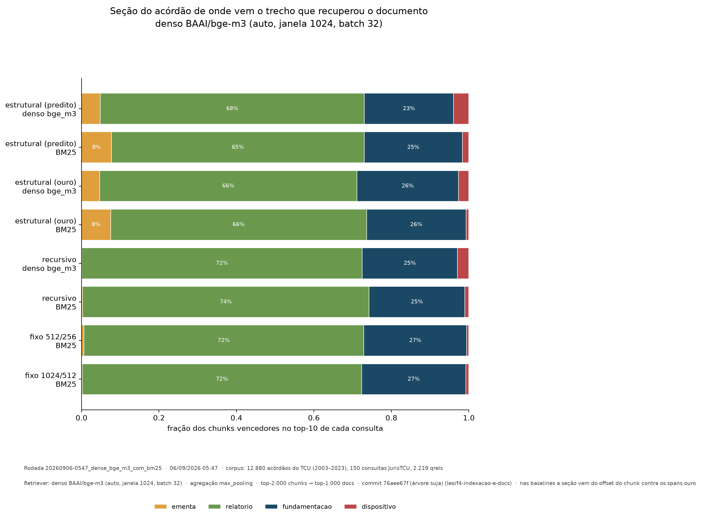

# Resultados — retriever denso (3 de 5 estratégias)

**Rodada:** `20260906-0547_dense_bge_m3` · **Data:** 06/09/2026 05:47 → 10:44 (4,94h)
**Modelo:** `BAAI/bge-m3` fp16, janela 1024, batch 32, RTX 5060
**Corpus:** 12.880 acórdãos · 150 consultas · 2.219 qrels · **Commit:** `76aee67f`
**Estratégias:** structural_gold, structural_pred, recursive_default
**Faltam:** `fixed_1024_512` e `fixed_512_256` — o orçamento de 5h as recusou
(estimadas 2,8h e 5,6h com 4,9h já usadas). Rodando agora, com o cache das
três primeiras.

---

## 1. O resultado que muda a leitura do trabalho

**A ordem das estratégias se inverteu entre os dois retrievers.**

| Estratégia | BM25 | Denso (bge-m3) |
|---|---:|---:|
| structural_pred | **0,2526** 🥇 | 0,1912 🥈 |
| structural_gold | 0,2521 🥈 | 0,1847 🥉 |
| recursive_default | 0,2412 🥉 (último) | **0,1967** 🥇 |

No BM25, o `recursive_default` era o **pior** dos cinco. No denso, é o
**melhor** dos três. E as estruturais, que lideravam no BM25, ficam por último.

Isso **contraria a hipótese do trabalho** e confirma, em parte, o que o teste
piloto tinha antecipado ([03-previsao-denso.md](03-previsao-denso.md)): a
previsão registrada acertou que a fronteira de seção pesaria mais no denso, e
errou a direção — ela pesa **contra** o chunking estrutural.

## 2. O primeiro resultado ESTATISTICAMENTE SIGNIFICATIVO do TCC

Até aqui nenhuma comparação passava de p = 0,097. Cruzando os dois retrievers,
**15 dos 28 pares são significativos** — e todos são BM25 contra denso.

| Comparação (mesma estratégia) | p-valor | Vitórias BM25 / empates / vitórias denso |
|---|---:|---|
| structural_gold: BM25 × denso | **0,000005** | 83 / 25 / 42 |
| structural_pred: BM25 × denso | **0,000010** | 83 / 21 / 46 |
| recursive_default: BM25 × denso | **0,002189** | 80 / 23 / 47 |

**O BM25 supera o retriever denso com significância forte, em todas as
estratégias.** É o achado mais sólido que o trabalho tem até agora.

E **dentro do denso, nada é significativo** (p = 0,21 a 0,58): a vantagem do
recursivo sobre as estruturais (+0,012 em nDCG@10) não se sustenta
estatisticamente. O resultado nulo sobre chunking se mantém — agora nos **dois**
retrievers.

> Verificado que não é erro de configuração: pooling **CLS** (o correto para o
> bge-m3), camada `Normalize` ativa, prefixo vazio (o modelo dispensa), janela
> de 1024 com **0% de truncamento** e fp16 validado contra fp32 (nDCG relativo
> 0,9995). Ver [../05-modelos-embedding.md](../05-modelos-embedding.md).

### Isso é coerente com a literatura

O artigo já cita `pereira2026jua`, que observa que **baselines lexicais seguem
competitivas em RI jurídica em português**. E o JurisTCU mostrou modelos
BERT-based indo mal — só os embeddings da OpenAI superaram o BM25 lá. Nosso
resultado é mais forte que "competitivas": num corpus de documentos **íntegros
e longos**, o BM25 vence um bi-encoder multilíngue de 568M com significância.

Explicação plausível, a discutir no artigo: o vocabulário jurídico do TCU é
técnico e recorrente ("tomada de contas especial", "débito imputado",
"9.1"), o que favorece casamento lexical exato; e o embedding de um chunk de
~770 tokens é uma média semântica que dilui o termo específico da consulta.

## 3. Recortes

### Por tipo de consulta — a ordem inverte de novo

| Estratégia | pergunta (LLM) | expressão (LLM) | **consulta real (log)** |
|---|---:|---:|---:|
| recursive_default | **0,2632** 🥇 | **0,2301** 🥇 | 0,0970 (último) |
| structural_pred | 0,2383 | 0,2276 | **0,1078** 🥇 |
| structural_gold | 0,2400 | 0,2165 | 0,0977 |

**Nas consultas sintéticas o recursivo ganha; nas consultas reais de usuário,
o estrutural predito ganha** — e por margem relativa maior (+11% sobre o
recursivo). É o inverso do que acontece nas sintéticas.

Vale investigar, mas com cautela: são 50 consultas por grupo, sem
significância, e o nível absoluto nas consultas reais é baixíssimo (0,10).
**Não usar isso como salvação da hipótese** — é uma pista para o recorte
analítico, não um achado.

### Por tamanho de documento

| Estratégia | curto | médio | longo |
|---|---:|---:|---:|
| recursive_default | 0,1934 | **0,1893** | **0,2075** |
| structural_pred | **0,2010** | 0,1775 | 0,1952 |
| structural_gold | 0,1872 | 0,1732 | 0,1937 |

Diferente do BM25, aqui **não há inversão por tercil**: o recursivo lidera em
médios e longos. A tendência que o BM25 mostrava (estrutural melhor em
documentos longos) **não se reproduz no denso**.

### Por seção do acórdão

| Run | ementa | relatório | fundamentação | dispositivo |
|---|---:|---:|---:|---:|
| structural_pred · BM25 | 7,7% | 65,3% | 25,3% | 1,7% |
| structural_gold · BM25 | 7,5% | 66,1% | 25,7% | 0,7% |
| recursive · BM25 | 0,3% | 74,0% | 24,7% | 1,1% |
| structural_pred · denso | 4,9% | 68,1% | 23,1% | **3,9%** |
| structural_gold · denso | 4,7% | 66,5% | 26,2% | **2,7%** |
| recursive · denso | 0,1% | 72,4% | 24,6% | **2,9%** |

Dois pontos:

1. **O descompasso persiste no denso.** A relevância julgada mora na
   fundamentação (72% — ver [../03-analise-do-dominio.md](../03-analise-do-dominio.md)),
   mas ambos os retrievers recuperam predominantemente pelo **relatório**
   (65–74%). Não é um artefato do BM25: é o efeito de o relatório ocupar 70% do
   texto e, portanto, gerar 70% dos chunks candidatos.
2. **O denso recupera 3–4x mais pelo dispositivo** que o BM25 (2,7–3,9% contra
   0,7–1,7%). O dispositivo é formulaico ("ACORDAM os Ministros… 9.1…"), com
   pouca variação lexical — o BM25 raramente o escolhe, o embedding sim.

## 4. Custo e infraestrutura (para a seção de Materiais)

| | |
|---|---|
| Encode | 842.067 chunks em 4,94h (48,2–48,6 chunks/s sustentados) |
| Por estratégia | ~98,5 min cada, muito estável |
| Cache gerado | 1,09 GB por estratégia (`.npy` fp32, dim 1024) |
| Checkpoint | blocos de 25k chunks; a rodada seguinte reaproveitou tudo sem reencodar |
| Projeção vs real | 1,70h previstas × 1,64h reais no `structural_gold` — erro de 3,5% |

O orçamento adaptativo recusou as duas estratégias fixas com a estimativa
correta (2,8h e 5,6h contra 0,1h restante), em vez de começar e ser
interrompido no meio.

## 5. O que isso significa para o TCC

**A hipótese não se sustenta em nenhum dos dois retrievers.** Mas o trabalho
tem agora três resultados que valem publicação:

1. **BM25 > denso, com significância** (p < 0,01 nas três estratégias) em
   recuperação sobre acórdãos íntegros. Resultado sólido e contraintuitivo para
   quem assume que "denso é melhor".
2. **O chunking não importa** — nem no lexical, nem no semântico. Resultado
   nulo, mas medido com poder estatístico declarado e mecanismo investigado.
3. **O erro do segmentador não custa nada**: `structural_gold` × `structural_pred`
   dá p = 0,283 no denso (e 0,827 no BM25), com o *predito* à frente nos dois.
   Não é preciso ter a estrutura ouro.

**O que falta para fechar:** as duas estratégias fixas no denso, que estão
rodando. Elas completam a tabela 5 × 2 e permitem testar se a inversão
(recursivo melhor no denso) se mantém quando as fixas entram.
