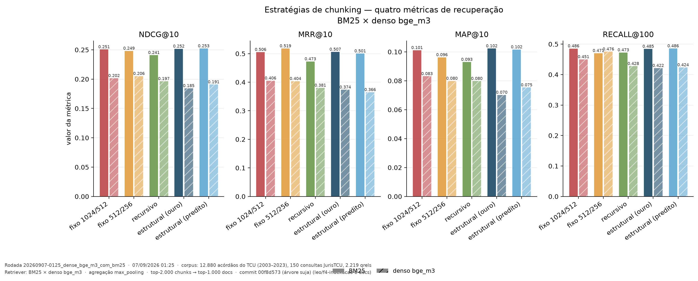
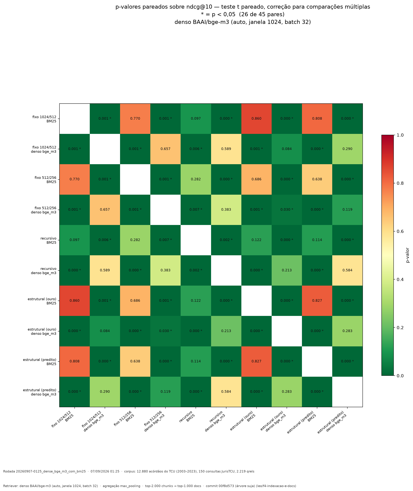
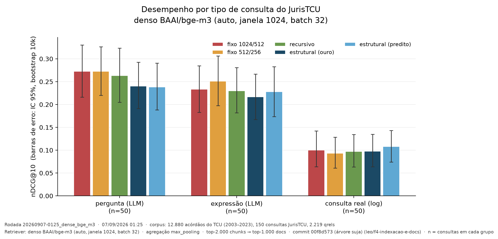
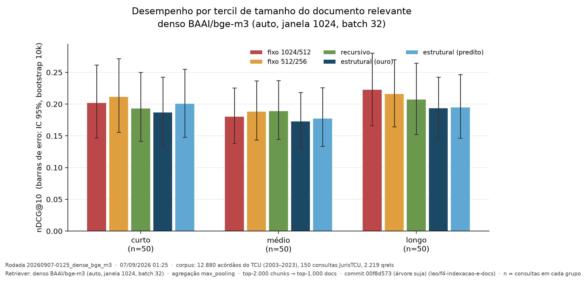
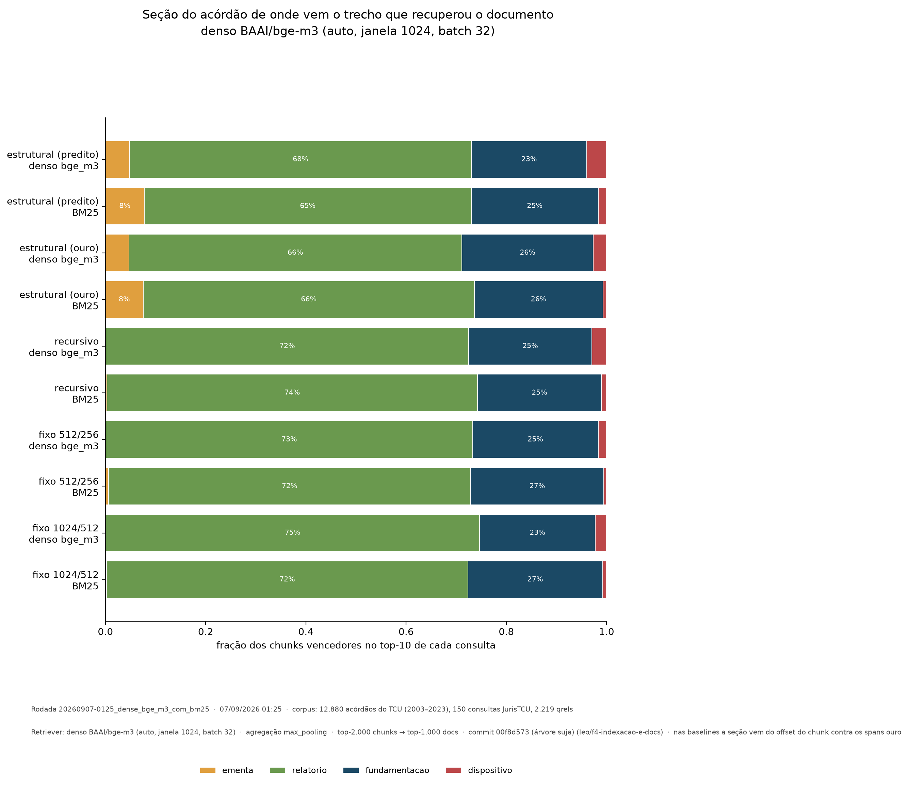

# Resultado final — 5 estratégias × 2 retrievers

**Rodadas:** `20260906-0515_bm25` + `20260907-0125_dense_bge_m3` · **Data:** 06–07/09/2026
**Corpus:** 12.880 acórdãos do TCU · 150 consultas · 2.219 qrels
**Retrievers:** BM25 (`bm25s`) e denso (`BAAI/bge-m3` fp16, janela 1024, RTX 5060)
**Status:** ✅ experimento completo — é o resultado que vai para o artigo

---

## A tabela

| Estratégia | BM25 nDCG@10 | Denso nDCG@10 | BM25 R@100 | Denso R@100 |
|---|---:|---:|---:|---:|
| structural_pred | **0,2526** | 0,1912 | **0,4863** | 0,4241 |
| structural_gold | 0,2521 | 0,1847 | 0,4849 | 0,4220 |
| fixed_1024_512 | 0,2510 | 0,2019 | 0,4861 | 0,4507 |
| fixed_512_256 | 0,2486 | **0,2055** | 0,4709 | **0,4759** |
| recursive_default | 0,2412 | 0,1967 | 0,4731 | 0,4283 |

## 1. A inversão é quase perfeita

| Posição | BM25 | Denso |
|---|---|---|
| 1º | structural_pred | **fixed_512_256** |
| 2º | structural_gold | fixed_1024_512 |
| 3º | fixed_1024_512 | recursive_default |
| 4º | fixed_512_256 | structural_pred |
| 5º | recursive_default | **structural_gold** |

As **duas estratégias estruturais** são 1ª e 2ª no BM25 e **4ª e 5ª no denso**.
As **duas fixas** são 3ª e 4ª no BM25 e **1ª e 2ª no denso**. A inversão é
sistemática, não ruído de uma configuração isolada.

**Leitura:** não existe uma estratégia de chunking melhor em geral — a melhor
depende do retriever, e o efeito é pequeno demais para ser explorado. É
evidência **contra** a hipótese do trabalho, e mais forte do que um empate
seria, porque mostra que o sinal muda de sinal conforme o contexto.

## 2. Significância: 26 de 45 pares

| Grupo de comparações | Pares | Significativos |
|---|---:|---:|
| Entre estratégias, dentro do **BM25** | 10 | **0** (menor p = 0,097) |
| Entre estratégias, dentro do **denso** | 10 | **1** (menor p = 0,030) |
| **BM25 × denso**, mesma estratégia | 5 | **5** ✅ |
| Cruzados (estratégia e retriever diferentes) | 20 | 20 |

### 2.1 O BM25 vence o denso em todas as cinco estratégias

| Estratégia | p | BM25 vence / empata / perde |
|---|---:|---|
| structural_gold | **0,000005** | 83 / 25 / 42 |
| structural_pred | **0,000010** | 83 / 21 / 46 |
| fixed_1024_512 | **0,000793** | 81 / 22 / 47 |
| fixed_512_256 | **0,000854** | 75 / 23 / 52 |
| recursive_default | **0,002189** | 80 / 23 / 47 |

**É o resultado mais sólido do trabalho.** Num corpus de acórdãos íntegros, o
BM25 supera um bi-encoder multilíngue de 568M com p < 0,01 em todas as
configurações testadas. Coerente com `pereira2026jua` e com o JurisTCU (onde os
BERT-based foram os piores), mas mais forte que "competitivo": é superioridade
consistente e significativa.

### 2.2 A única diferença significativa entre estratégias — e é contra a hipótese

`fixed_512_256` × `structural_gold`, no denso: **p = 0,0295**, com 68 vitórias
do fixo contra 51 do estrutural em 150 consultas.

**O chunking fixo supera o estrutural**, que é o oposto do que o trabalho
previa. E é a única de 20 comparações entre estratégias que passa de p < 0,05.

⚠️ **Mas é um resultado de fronteira, e precisa ser reportado como tal.** A
análise de poder mostra: diferença observada de 0,0208, **MDE de 0,0265** para
poder de 80%. Não há contradição entre "significativo a p = 0,03" e "abaixo do
MDE" — o MDE é o efeito detectável *com 80% de poder*, e um efeito menor pode
ser detectado com poder inferior. Na prática: **a detecção tem poder abaixo de
80%, e o achado precisa de replicação antes de virar afirmação forte.**

Também vale lembrar que são 45 comparações; mesmo com correção, um único
p = 0,03 no limiar merece cautela.

## 3. Recall@100: o denso tem uma vantagem

Onde o denso não perde: a `fixed_512_256__dense` tem **R@100 = 0,4759**, o
segundo melhor de toda a tabela, atrás só da `fixed_1024_512__bm25` (0,4861).

O denso recupera mais documentos distintos por consulta — a similaridade
semântica raramente zera, enquanto o BM25 só pontua documento que contenha
algum termo da consulta. **Ele erra a ordenação no topo, mas cobre bem a
cauda.** Isso sugere que uma fusão híbrida (BM25 para ordenar, denso para
cobrir) seria proveitosa — está na lista de trabalhos futuros.

## 4. Recortes

### Por tipo de consulta

O efeito dominante continua sendo o **tipo de consulta**, não a estratégia:
consultas reais de log rendem menos da metade das sintéticas, nos dois
retrievers. A escolha de chunking é decisão de segunda ordem perto disso.

### Por tamanho de documento e por seção

O descompasso se mantém nas dez configurações: **65–74% dos chunks vencedores
vêm do relatório**, que tem 66,8% dos chunks e apenas 25,7% da relevância. É o
que motivou o experimento de [filtragem por seção](05-filtragem-por-secao.md),
que melhorou o nDCG@10 em 16,9%.

## 5. Custo total do experimento

| Etapa | Custo |
|---|---|
| Download dos dados | 6,0 GB, ~2 h |
| Montagem do corpus | ~30 min (lê 6 GB de CSV) |
| Chunking (5 estratégias) | ~50 min, 2.200.767 chunks, 6,0 GB |
| BM25 (5 estratégias) | 24,5 min em CPU |
| Denso (5 estratégias) | **~10 h** de RTX 5060, em três rodadas com checkpoint |
| Cache de embeddings | 6,3 GB (`.npy` fp32, dim 1024) |

A terceira rodada foi interrompida por desligamento da máquina e **retomou do
checkpoint sem reencodar** os 14 blocos já salvos — economizou ~1 h.

## 6. O que isto significa para o TCC

**A hipótese não se confirmou**, e o trabalho tem evidência mais forte do que um
simples empate: a ordem das estratégias **inverte** entre retrievers, e a única
diferença significativa aponta **contra** o chunking estrutural.

Mas o trabalho entrega quatro resultados:

1. **BM25 > denso com significância** nas cinco estratégias (p < 0,01)
2. **O chunking não importa** — 0 de 10 pares no BM25, 1 de 10 no denso (e esse
   no limiar, contra a hipótese)
3. **O erro do segmentador não custa nada** — `gold` × `pred` dá p = 0,827
   (BM25) e 0,283 (denso); não é preciso ter a estrutura ouro
4. **Filtrar o relatório do índice melhora 16,9%** (p = 0,001) — a intervenção
   que saiu do achado de domínio, [documentada em separado](05-filtragem-por-secao.md)

O terceiro e o quarto são originais e não existem na literatura consultada.
